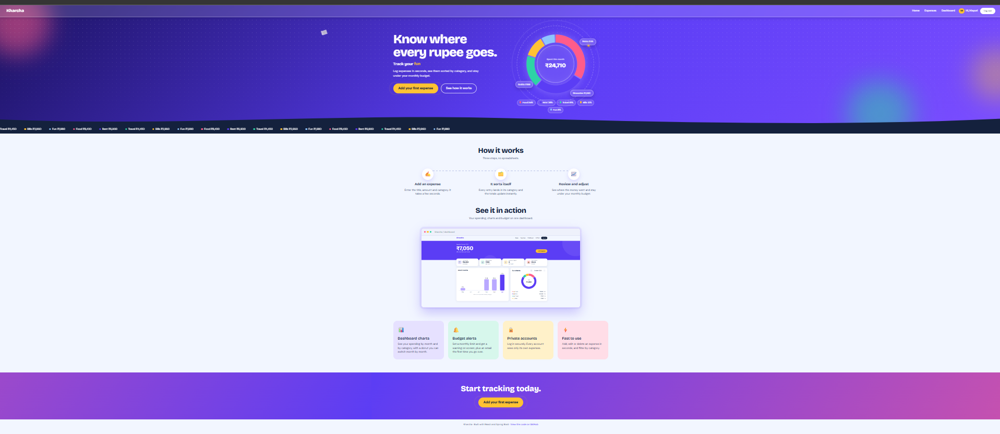
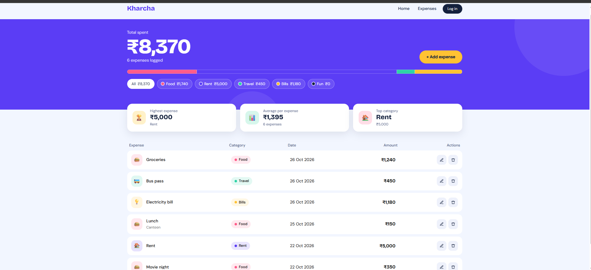
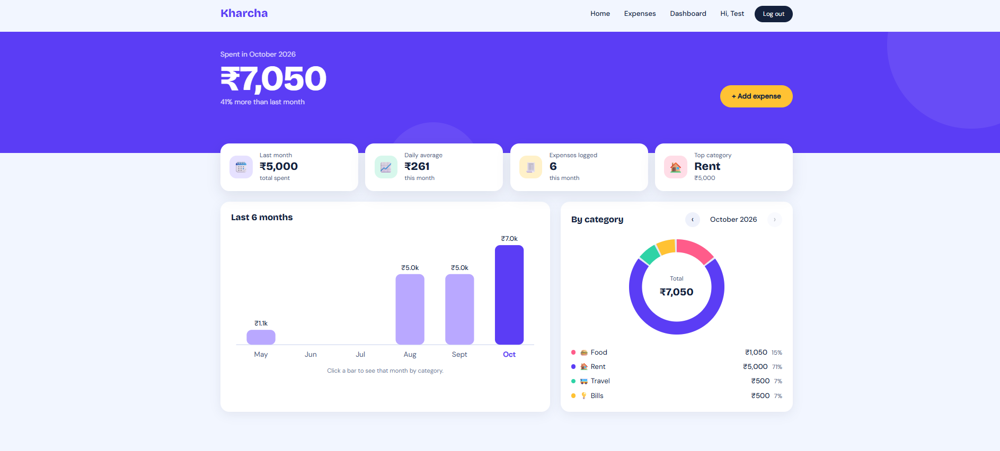

# Kharcha - Expense Tracker

A full-stack expense tracker where you can create an account, log your spending, sort it by category and see where your money goes. Built with React, Spring Boot and MySQL.

## Screenshots







## Features

- Register and log in with JWT authentication; every user sees only their own expenses
- Add, edit and delete expenses
- Filter expenses by category (Food, Rent, Travel, Bills, Fun)
- Live totals, a category breakdown bar, and summary tiles for the highest expense, the average expense and the top category
- Animated home page and a split-screen login page
- Passwords are stored hashed with BCrypt
- Data stored in MySQL through a REST API
- Dashboard with a 6-month spending bar chart and a category donut you can switch month by month
- Monthly budget with a progress bar and a yellow/red warning as you approach or pass your limit
- Email alert to your registered address the first time you go over budget each month (sent through the Brevo email API)

## Tech Stack

| Layer | Technology |
|---|---|
| Frontend | React (Vite), Bootstrap, React Router, Axios |
| Backend | Java 17, Spring Boot, Spring Data JPA, Spring Security (JWT), REST APIs |
| Database | MySQL |
| Email | Brevo transactional email API |

## API Endpoints

Authentication endpoints are open. All expense endpoints need a login token in the `Authorization: Bearer <token>` header.

| Method | Endpoint | Description |
|---|---|---|
| POST | `/api/auth/register` | Create an account and get a token |
| POST | `/api/auth/login` | Log in and get a token |
| GET | `/api/expenses` | List your expenses |
| POST | `/api/expenses` | Add an expense |
| PUT | `/api/expenses/{id}` | Update an expense |
| DELETE | `/api/expenses/{id}` | Delete an expense |
| GET | `/api/budget` | Get your monthly budget |
| PUT | `/api/budget` | Set or change your monthly budget |
| DELETE | `/api/budget` | Remove your monthly budget |

## Getting Started

To enable the over-budget email alert, also add your Brevo details to the same file. Without them the app still works, it just skips the emails:

properties
brevo.api-key=YOUR_BREVO_API_KEY
brevo.sender-email=YOUR_VERIFIED_SENDER_EMAIL
brevo.sender-name=Kharcha

### Prerequisites

- Java 17 or higher
- Node.js (LTS)
- MySQL 8

### 1. Create the database

```sql
CREATE DATABASE expense_tracker;
```

### 2. Run the backend

Create the file `backend/src/main/resources/application-local.properties` with your MySQL password and a secret key for signing login tokens (any random text of at least 32 characters). This file is ignored by Git, so your secrets are never uploaded:

```properties
spring.datasource.password=YOUR_MYSQL_PASSWORD
app.jwt.secret=REPLACE_WITH_A_LONG_RANDOM_TEXT_OF_32_OR_MORE_CHARACTERS
```

Then start the server:

```bash
cd backend
./mvnw spring-boot:run
```

The API runs on `http://localhost:8081`. On Windows PowerShell, use `.\mvnw spring-boot:run`.

### 3. Run the frontend

```bash
cd frontend
npm install
npm run dev
```

Open `http://localhost:5173`, create an account and add your first expense.

## Roadmap

- Deployment

## Author

Prajakta Kar - [GitHub](https://github.com/Prajakta-kar)